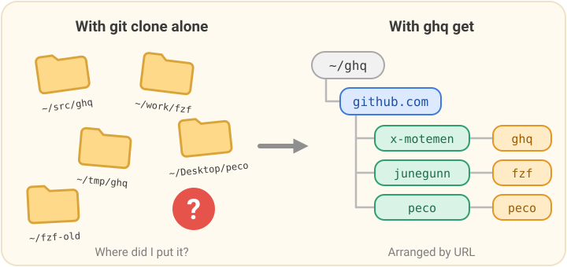

# Introduction

> The English edition is a work in progress. So far only this page and the opening page of the Quick tour chapter have been translated. The full book is available in [Japanese](../ja/).

Can you say where every repository you have cloned lives? Some are under `~/src`, some under `~/work`, and a few sit right in your home directory because you only meant to try them out. `git clone` creates the clone in the current directory unless you name a destination, so where a repository ends up depends on where you happened to be that day. A few months later you find the same repository cloned twice, or you reach for `find` to locate the one you want.



ghq is a command-line tool that decides that location from the URL. Getting `https://github.com/x-motemen/ghq` puts the clone at `~/ghq/github.com/x-motemen/ghq`. You no longer have to choose where things go, and once you know the URL, you know the directory.

## Audience

This book is for developers who use Git every day. ghq is written in Go, but you do not need to know Go to use it.

## Version

The explanations and examples in this book are based on ghq 1.12.0, released on November 3, 2026. Check your version with `ghq --version`.

## Conventions

Command lines start with `$` to set them apart from their output. The examples use the login name `alice` and the home directory `/home/alice`.

```console
$ ghq root
/home/alice/ghq
```

## Reading this book

For everyday work, the [Quick tour](tour/README.md) chapter in Part 1 is all you need. Part 2 explains how `ghq get` works in detail and how to fetch many repositories at once through a pipe, and Part 3 explains how to narrow down the output of `ghq list`. Part 4 collects the tasks that manage where repositories live: configuring roots, moving existing clones, and creating and removing repositories. From Part 2 on, you can go straight to the part you need.
