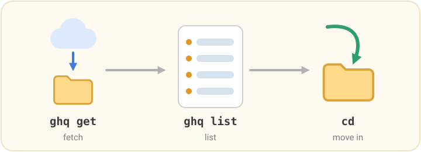

# Quick tour

> The rest of this chapter has not been translated yet. It is available in the [Japanese edition](../../ja/tour/).

Most of what you do with ghq day to day repeats three actions: fetch a repository, list the repositories you have, and move into one of them.

`ghq get` fetches and `ghq list` lists. Moving is the job of `cd`, because ghq itself never changes your directory. Both commands print repository paths, so you pass their output to `cd`.
