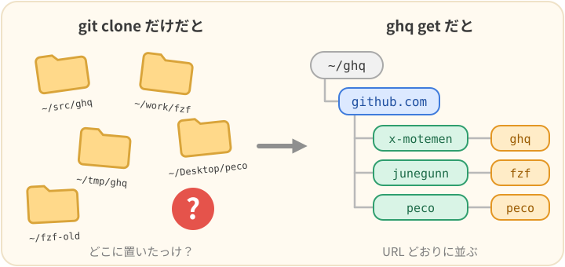

# はじめに

手元にクローンしたリポジトリの場所を、すべて言えるだろうか。`~/src` に置いたもの、`~/work` に置いたもの、ちょっと試すつもりでホームディレクトリの直下に置いたもの。`git clone` はクローン先を指定しなければカレントディレクトリに作るので、置き場所はその日にいたディレクトリで決まる。数か月たつと、同じリポジトリを二度クローンしていたり、目当てのリポジトリを `find` で探したりすることになる。



ghq はこの置き場所を URL から決めるコマンドラインツールである。`https://github.com/x-motemen/ghq` を取得すると、クローン先は `~/ghq/github.com/x-motemen/ghq` になる。置き場所を考える必要がなくなり、URL が分かればディレクトリも分かる。

## 対象読者

Git を日常的に使っている開発者を想定している。ghq は Go で書かれているが、使うだけなら Go の知識はいらない。

## 対象バージョン

本書の説明と実行例は ghq 1.12.0（2026 年 11 月 3 日リリース）にもとづく。手元のバージョンは `ghq --version` で確かめられる。

## 表記

コマンドの入力行は `$` で始めて、出力と区別する。実行例のログイン名は `alice`、ホームディレクトリは `/home/alice` とした。

```console
$ ghq root
/home/alice/ghq
```

## 読み方

日々の操作は第 1 部の[「ひととおり使ってみる」](tour/README.md)の章で足りる。第 2 部では `ghq get` の細かい動きと、パイプでまとめて取得する方法を、第 3 部では `ghq list` の絞り込み方を説明する。第 4 部にはルートの設定、既存のクローンの移動、リポジトリの作成と削除といった、置き場所を管理する操作をまとめた。第 2 部から先は必要なところから引ける。
