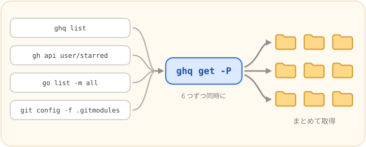

# パイプでまとめて取得する

新しいマシンを用意したときや、ある Organization のリポジトリを一通り読みたいときは、何十ものリポジトリを一度に取ってくることになる。一つずつ `ghq get` するには多すぎる。

`ghq get` は、引数を渡さずに実行すると、取得するリポジトリを標準入力から 1 行ずつ読む。リポジトリの URL や名前を 1 行に一つずつ出力するコマンドなら、どれでも `ghq get` の前に置ける。



```console
$ printf '%s\n' x-motemen/ghq junegunn/fzf peco/peco | ghq get -P
```

標準入力の 1 行は引数の一つと同じように扱われる。URL でも、`ホスト/オーナー/リポジトリ名` でも、`オーナー/リポジトリ名` でもよい。

## `-P`: 並列に取得する

まとめて取得するときは `-P`（`--parallel`）を付けるとよい。最大で 6 つを同時に取得する。複数のリポジトリを引数に並べたときにも使える。

`-P` を付けると、途中で失敗したリポジトリがあってもエラーをログに出して残りを続ける。付けないと、最初に失敗したリポジトリで止まる。また、`-P` のときは VCS のコマンドの出力を出さない（ghq のログは出る）。

## 空行に気をつける

空行もリポジトリ名として読まれ、エラーになる。入力に空行が混ざるなら、`grep .` を挟んで取り除いておく。

```console
$ printf 'x-motemen/ghq\n\nSongmu/gitconfig\n' | ghq get -P
    exists /home/alice/ghq/github.com/x-motemen/ghq
/home/alice/ghq/github.com/x-motemen/ghq
    exists /home/alice/ghq/github.com/Songmu/gitconfig
/home/alice/ghq/github.com/Songmu/gitconfig
     error failed to get "": not a valid repository: https://github.com/alice/
```
