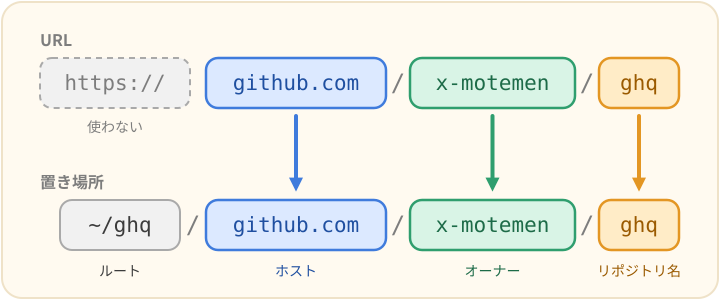

# `ghq` の考え方

ghq はリモートリポジトリのクローンを管理するコマンドラインツールである。motemen 氏が作り、現在は x-motemen organization のリポジトリ（<https://github.com/x-motemen/ghq>）で開発が続いている。Go で書かれた単一の実行ファイルで、ライセンスは MIT である。

## クローン先を URL から決める

ghq がすることを一文で言えば、受け取った URL から決まるディレクトリにリポジトリをクローンする、となる。`ghq get` に URL を渡すと、ghq は URL のホストとパスからクローン先を決めて、`git clone` を実行する。

```console
$ ghq get https://github.com/x-motemen/ghq
     clone https://github.com/x-motemen/ghq -> /home/alice/ghq/github.com/x-motemen/ghq
       git clone --recursive https://github.com/x-motemen/ghq /home/alice/ghq/github.com/x-motemen/ghq
Cloning into '/home/alice/ghq/github.com/x-motemen/ghq'...
Got the repo to the following:
/home/alice/ghq/github.com/x-motemen/ghq
```

URL から `https://` を取り除き、残りをルートの下に階層として並べる。ルートは ghq がリポジトリを置く起点のディレクトリで、何も設定しなければ `~/ghq` を使う。



クローン先は `ルート/ホスト/オーナー/リポジトリ名` の形になる。何本クローンしても、ルートの下はホストとオーナーごとに分かれた木になる。

```text
~/ghq
├── github.com
│   ├── junegunn
│   │   └── fzf
│   ├── peco
│   │   └── peco
│   └── x-motemen
│       └── ghq
└── gitlab.com
    └── alice
        └── dotfiles
```

この並べ方は、Go がかつてソースコードを `$GOPATH/src/github.com/...` に置いていたのと同じ考え方である。ghq の README もこの動きを「`go get` のように」と説明している。

## 置き場所が URL で決まると何が変わるか

置き場所の決め方が一つになると、クローンにまつわる手間がいくつか消える。

- クローンするたびに、置き場所を考えなくてよい。
- URL と場所が対応する。`~/ghq/github.com/x-motemen/ghq` にいるなら、そのリポジトリは `https://github.com/x-motemen/ghq` にある。逆に URL を見れば、手元のどこにあるかが分かる。
- 同じリポジトリを二度クローンしない。`ghq get` は、クローン済みのリポジトリには何もしない。
- 手元のリポジトリを一覧できる。`ghq list` はルートの下のリポジトリを 1 行に 1 つずつ出力するので、`grep` や `fzf` とそのまま組み合わせられる。

GitHub のリポジトリに限らず、ほかのホストのリポジトリも、Git 以外のバージョン管理システムのリポジトリも同じように扱える。対応している範囲は[「GitHub 以外のホスト」](get/hosts.md)と[「VCS の判定と `--vcs`」](get/vcs.md)で説明する。

## サブコマンド

ghq の機能は次の六つのサブコマンドに分かれている。

| コマンド | すること |
|---|---|
| `ghq get` | リポジトリをクローンする。クローン済みなら何もしない（`-u` を付けると更新する） |
| `ghq list` | 手元のリポジトリを一覧する |
| `ghq root` | ルートを表示する |
| `ghq create` | 新しいリポジトリをルートの下に作る |
| `ghq rm` | 手元のリポジトリを削除する |
| `ghq migrate` | ルートの外にあるリポジトリを、ルートの下の決まった場所へ移す |

`ghq clone` は `ghq get` の別名で、同じように使える。
