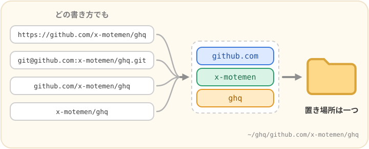

# `ghq get` が引数を置き場所に変えるまで

`ghq get` は、引数の文字列から置き場所を決めるまでに、いくつかの段階を踏む。この順番を知っておくと、オプションや設定がどの段階に関わるのかが分かりやすい。

1. 文字列を URL に直す。`x-motemen/ghq` のような省略形には `https://github.com/` を補い、SCP 形式の `git@github.com:x-motemen/ghq.git` は `ssh://git@github.com/x-motemen/ghq.git` に直す。リポジトリ名だけならオーナーを補い（[「オーナーとホストの補われ方」](owner.md)）、`./` や `../` で始まる相対パスはルートからの位置として読み替える（[「相対パスで隣のリポジトリを取る」](relative.md)）。`-p` が付いていれば SSH の URL にする（[「SSH での取得と認証」](ssh.md)）。
2. URL のパスに `@` があれば、その後ろをブランチ名として切り出す（[「ブランチと履歴を絞ってクローンする」](narrow.md)）。
3. 手元にクローン済みかを、すべてのルートから探す。見つかれば何もしない。`-u` があれば更新する（[「`-u` / `--update`: クローン済みのリポジトリを更新する」](update.md)）。
4. 見つからなければ置き場所を決める。URL ごとのルートが設定されていればその下、なければ主ルートの下の `ホスト/オーナー/リポジトリ名` になる（[「`ghq.<url>.root`: 仕事と個人でルートを分ける」](../root/url-root.md)）。
5. VCS を決める。github.com なら Git を使い、それ以外のホストでは設定やリモートへの問い合わせで判定する。`--vcs` があればそれに従う（[「VCS の判定と `--vcs`」](vcs.md)）。
6. VCS のコマンドでクローンする。

ルートの下の `ホスト/オーナー/リポジトリ名` を決めるのは、URL のホストとパスだけである。HTTPS か SSH か、どのブランチかは関わらない。手元のリポジトリもこの相対パスで探すので、プロトコルやブランチを変えて同じリポジトリを二度クローンすることはない。
