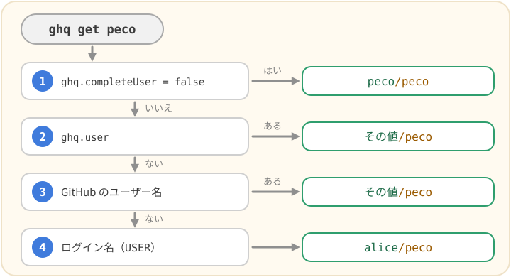

# オーナーとホストの補われ方

`ghq get` には `ghq get dotfiles` のようにリポジトリ名だけを渡すこともできる。このとき ghq はオーナーを補うが、補われるのが自分の GitHub のユーザー名とは限らない。

```console
$ ghq get dotfiles
     clone https://github.com/alice/dotfiles -> /home/alice/ghq/github.com/alice/dotfiles
```

何も設定していなければ、この `alice` はログイン名（環境変数 `USER`）である。GitHub のユーザー名がログイン名と違うと、存在しないリポジトリをクローンしようとして失敗するか、同じ名前のほかの人のリポジトリをクローンしてしまう。

## オーナーを補う順番

ghq は次の順に調べて、最初に見つかった値をオーナーにする。



1. Git の設定 `ghq.completeUser` が `false` なら、リポジトリ名をそのままオーナーにも使う（`peco` なら `peco/peco`）。
2. Git の設定 `ghq.user` の値。
3. GitHub のユーザー名として設定されている値。環境変数 `GITHUB_USER` や Git の設定 `github.user` を見る。
4. 環境変数 `USER`（Windows では `USERNAME`）。

3 で調べる値を細かく言うと、次の順になる。どれかを設定した覚えがあるのに意図しないオーナーになるときは、この順で確かめるとよい。

1. 環境変数 `GITHUB_USER`
2. hub コマンドの設定ファイル（`~/.config/hub`）のユーザー名
3. Git の設定 `credential.username`（`https://github.com` に当てはまるもの）
4. Git の設定 `github.user`
5. Git の設定 `user.email` のメールアドレスで GitHub の API を検索して見つかったユーザー名
6. Git の設定 `user.username`

## 自分のリポジトリをよく取るなら `ghq.user`

GitHub のユーザー名を `ghq.user` に書いておけば、ログイン名に左右されない。GitHub のユーザー名が `alice-dev` なら、次のように設定する。

```console
$ git config --global ghq.user alice-dev
$ ghq get dotfiles
     clone https://github.com/alice-dev/dotfiles -> /home/alice/ghq/github.com/alice-dev/dotfiles
```

## 同名のリポジトリをよく取るなら `ghq.completeUser`

`peco/peco`、`vim/vim`、`ruby/ruby` のように、オーナー名とリポジトリ名が同じリポジトリは多い。こうしたリポジトリをよく取るなら、`ghq.completeUser` を `false` にする。リポジトリ名をオーナーにも使うようになる。

```console
$ git config --global ghq.completeUser false
$ ghq get peco
     clone https://github.com/peco/peco -> /home/alice/ghq/github.com/peco/peco
```

この設定は `ghq get` にだけ使われる。`ghq create` と `ghq rm` は `ghq.completeUser` にかかわらず 2 から 4 の順でオーナーを補う。

## ホストを省いたとき

ホストを省くと、ghq は `github.com` を補う。GitHub Enterprise Server や GitLab を主に使っているなら、`ghq.defaultHost` で補うホストを変えられる。

```console
$ git config --global ghq.defaultHost gitlab.com
$ ghq get alice/dotfiles
     clone https://gitlab.com/alice/dotfiles -> /home/alice/ghq/gitlab.com/alice/dotfiles
```

ただし、オーナーを補う 3 の手順は `ghq.defaultHost` を変えても github.com のユーザー名を探す。github.com 以外のホストでリポジトリ名だけを渡すなら、`ghq.user` を設定しておくほうが確実である。
