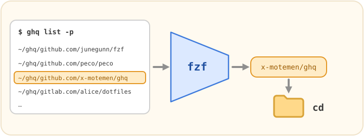

# `ghq list` の出力

`ghq list` の出力は 1 行に 1 つのリポジトリという単純な形をしている。この形のおかげで、出力を `grep`、`fzf`、`xargs`、そして `ghq get` 自身にもそのまま渡せる。



## 相対パスと絶対パス

何も付けなければ、ルートからの相対パスを名前順に出力する。`-p`（`--full-path`）を付けると絶対パスになる。

```console
$ ghq list
github.com/junegunn/fzf
github.com/x-motemen/ghq
$ ghq list -p
/home/alice/ghq/github.com/junegunn/fzf
/home/alice/ghq/github.com/x-motemen/ghq
```

出力をほかのコマンドに渡して場所として使うなら、`-p` を付けたほうがよい。相対パスにはどのルートの下にあるかが含まれないので、ルートが複数あると、`$(ghq root)/` を前に付けても主ルート以外のリポジトリの場所を誤る。

## 一覧に出るリポジトリ

`ghq list` は、すべてのルート（`ghq root --all` の出力）の下をたどり、VCS のディレクトリやファイル（`.git`、`.hg`、`.svn`、`_darcs`、`.pijul`、`.bzr`、Fossil の `.fslckout` と `_FOSSIL_`、CVS の `CVS/Repository`）を持つディレクトリをリポジトリとみなす。リポジトリを見つけると、その中にはもう入らない。

このたどり方から、一覧に出るものが決まる。

- `ghq get` を使わずに置いたリポジトリも、ルートの下にあれば出る。
- リポジトリの中にあるリポジトリ（サブモジュールや、リポジトリの中に作ったワークツリー）は出ない。
- ルートの下に置いたシンボリックリンクがリポジトリを指していれば、そのリポジトリも出る。

ルートの外にあるリポジトリをシンボリックリンクで一覧に加えることもできる。

```console
$ ln -s ~/projects/mytool ~/ghq/github.com/alice/mytool
$ ghq list mytool
github.com/alice/mytool
```
