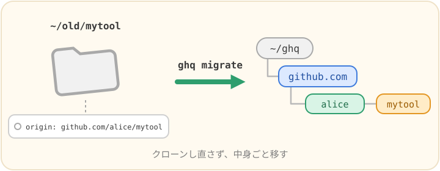

# `ghq migrate`: ルートの外のクローンを移す

ghq を使い始める前にクローンしたリポジトリは、ルートの外に散らばっている。クローンし直せば置き場所はそろうが、手元にしかないブランチや、コミットしていない変更は残らない。`ghq migrate` はディレクトリをそのままルートの下の決まった場所へ移す。



```console
$ ghq migrate ~/old/mytool
Migrate /home/alice/old/mytool to /home/alice/ghq/github.com/alice/mytool? [y/N]: y
/home/alice/ghq/github.com/alice/mytool
```

移し先はリポジトリのリモートの URL から決まる。Git なら `origin` の URL を使い、`origin` がなければ最初に見つかったリモートを使う。この例では `origin` が `git@github.com:alice/mytool.git` だったので、`github.com/alice/mytool` に移した。Git 以外の VCS でも、それぞれの方法でリモートの URL を読み取る。

`-y` を付けると確認を省く。`--dry-run` を付けると、移さずに移し先だけを表示する。

```console
$ ghq migrate --dry-run ~/old/mytool
Would migrate /home/alice/old/mytool to /home/alice/ghq/github.com/alice/mytool
```

## 移せないもの

次の場合、`ghq migrate` はエラーで止まり、何も移さない。

- リモートが設定されていない。
- 移し先にディレクトリがすでにある。
- すでに決まった場所にある。
- ディレクトリが Git のワークツリーかサブモジュールである（`.git` がディレクトリではなくファイルになっている）。単独で移すと、元のリポジトリとのつながりが切れるからだ。

移すリポジトリにリンクされたワークツリーがあるときは、移したあとに `git worktree repair` を実行して、ワークツリーからの参照を新しい場所に合わせる。

移し先が別のファイルシステムにあると、ディレクトリの名前を変えるだけでは移せない。このときはコピーしてから元を削除する。

## まとめて移す

散らばったリポジトリをまとめて移すなら、シェルのループで一つずつ渡す。まず `--dry-run` で移し先を確かめてから、`-y` を付けて移す。

```console
$ for dir in ~/old/*/; do ghq migrate --dry-run "$dir"; done
$ for dir in ~/old/*/; do ghq migrate -y "$dir"; done
```

リモートのないディレクトリはエラーになるが、ループは次のディレクトリに進む。
