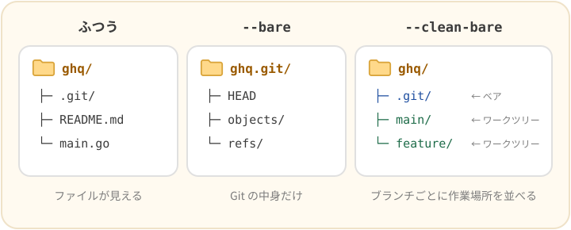

# `--bare` / `--clean-bare`: ワークツリーを並べる

一つのリポジトリで複数のブランチを同時に開くには、Git のワークツリー（`git worktree`）を使う。ところが ghq はブランチを置き場所に含めないので、ふつうにクローンしただけでは、ワークツリーを置く場所が決まらない。ベアリポジトリとしてクローンする `--bare` と `--clean-bare` を使うと、ワークツリーの置き場所を作れる。



## `--bare`

`--bare` を付けると、作業ツリーを持たないベアリポジトリとしてクローンする。置き場所の名前の末尾には `.git` が付く。

```console
$ ghq get --bare Songmu/gitconfig
     clone https://github.com/Songmu/gitconfig -> /home/alice/ghq/github.com/Songmu/gitconfig.git
       git clone --recursive --bare https://github.com/Songmu/gitconfig /home/alice/ghq/github.com/Songmu/gitconfig.git
Cloning into bare repository '/home/alice/ghq/github.com/Songmu/gitconfig.git'...
Got the repo to the following:
/home/alice/ghq/github.com/Songmu/gitconfig.git
```

`ghq list` にも `github.com/Songmu/gitconfig.git` と `.git` 付きで出る。`ghq rm` で消すときと、`-u` で更新するときは、`--bare` を付けて同じ名前を指定する。

```console
$ ghq get -u --bare Songmu/gitconfig
$ ghq rm --bare Songmu/gitconfig
```

## `--clean-bare`

`--clean-bare` はベアリポジトリを `リポジトリ名/.git` に置く。リポジトリのディレクトリ名に `.git` が付かず、その中にワークツリーを並べられる。

```console
$ ghq get --clean-bare Songmu/prompter
     clone https://github.com/Songmu/prompter -> /home/alice/ghq/github.com/Songmu/prompter
       git clone --recursive --bare https://github.com/Songmu/prompter /home/alice/ghq/github.com/Songmu/prompter/.git
Cloning into bare repository '/home/alice/ghq/github.com/Songmu/prompter/.git'...
Got the repo to the following:
/home/alice/ghq/github.com/Songmu/prompter
$ cd ~/ghq/github.com/Songmu/prompter
$ git worktree add main
Preparing worktree (checking out 'main')
HEAD is now at 96fd2c4 Merge pull request #15 from Songmu/tagpr-from-v0.5.1
```

`ghq list` にはふつうのクローンと同じ `github.com/Songmu/prompter` で出る。`main` のようなワークツリーはリポジトリのディレクトリの中にあるので、一覧には出ない。`ghq list` はリポジトリを見つけると、その中には入らないからだ。

`--bare` と `--clean-bare` を両方付けると、`--bare` は警告とともに無視される。

## `--clean-bare` のリポジトリを更新する

ワークツリーを作ったあとの `--clean-bare` のリポジトリは、`ghq get -u` ではうまく更新できない。`--clean-bare` を付けて実行すると、ワークツリーでチェックアウトしているブランチまで書き換えようとして、Git に拒否される。付けずに実行すると `git fetch` だけが動き、どのブランチも更新されない。

ベアリポジトリにはリモートのブランチを取り込む設定（`remote.origin.fetch`）がない。この設定を足しておけば、ふつうのリポジトリと同じように `git fetch` と `git pull` で更新できる。

```console
$ cd ~/ghq/github.com/Songmu/prompter
$ git config remote.origin.fetch '+refs/heads/*:refs/remotes/origin/*'
$ git fetch
$ cd main
$ git branch -u origin/main
$ git pull --ff-only
```

## ワークツリーごと削除する

`ghq rm` は、リポジトリにリンクされたワークツリーがあれば、まとめて削除する。何が消えるかは `--dry-run` で確かめられる。

```console
$ ghq rm --dry-run Songmu/prompter
Would remove /home/alice/ghq/github.com/Songmu/prompter and its 1 linked worktree(s):
  /home/alice/ghq/github.com/Songmu/prompter/main
```
